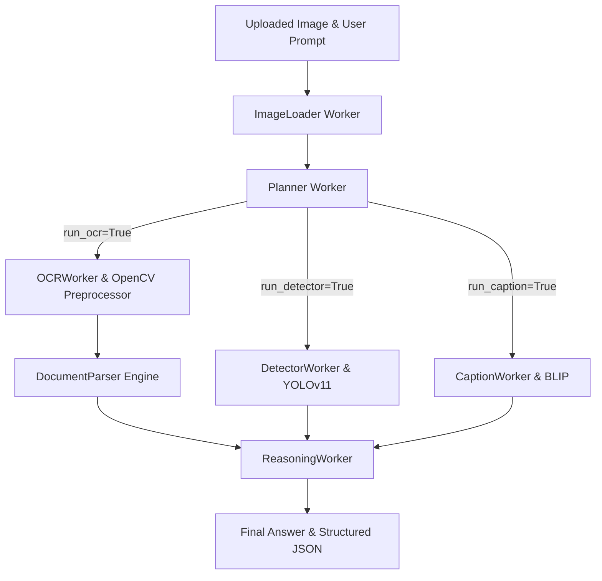

# 🤖 OmAgent Multi-Worker Image Processing & Document Intelligence Agent

A state-of-the-art, multi-worker computer vision and document intelligence system built with **OmAgent**, **PaddleOCR**, **OpenCV**, **YOLOv11**, **BLIP**, and **Streamlit**.

This application intelligent orchestrates specialized vision workers to process images and complex document forms—preserving full spatial text structure, running template/regex document parsers, detecting objects, and producing rich structured JSON responses.

---

## ✨ Key Features

- **📸 Advanced OpenCV Image Preprocessing**:
  - Auto-upscaling (2× interpolation) for low-resolution inputs.
  - Grayscale conversion and **CLAHE** (Contrast Limited Adaptive Histogram Equalization).
  - Noise reduction via light bilateral filtering.
  - Gaussian adaptive thresholding for optimal OCR character separation.

- **🔤 Spatial Line-Aware OCR (`tools/ocr.py`)**:
  - Powered by **PaddleOCR**.
  - Reconstructs text line breaks using bounding box coordinates ($Y$-centroid line clustering and $X$-coordinate sorting).
  - Eliminates structural text loss before downstream parsing.

- **📄 Document Parsing Engine (`tools/document_parser.py`)**:
  - **Dedicated B. Braun Discrepancy Notification (DN) Parser**: Extracts 14 explicit form fields (`Document ID`, `Version`, `Effective Date`, `Proc Ref#`, `Item #`, `Batch #`, `Machine/Line #`, `Who is involved`, `Where is the error`, `When did it happen`, `Other Details`, `Z7 DN #`, `A7 DN #`).
  - **Generic Document Parser**: Automatically identifies invoices, receipts, SOPs, quality forms, and shipping labels.

- **🎯 YOLOv11 Object Detection (`tools/detector.py`)**:
  - Identifies objects, bounding regions, and scene elements using lightweight `yolo11n.pt`.

- **🖼️ Image Captioning & Visual Scene Understanding**:
  - Generates descriptive natural-language summaries of visual imagery using BLIP/vision models.

- **🧠 Multi-Worker Planner & Reasoning Workflow**:
  - **Planner Worker**: Dynamically routes execution to necessary specialized workers based on user prompts.
  - **Reasoning Worker**: Synthesizes pre-extracted structured OCR JSON, YOLO detections, and image descriptions into precise answers.

- **🎨 Modern Glassmorphic Web Dashboard (`app.py`)**:
  - Interactive Streamlit UI with quick prompt presets, live execution progress indicators, worker execution timeline, and JSON download capability.

---

## 🏗️ System Architecture & Workflow



### Worker Responsibilities

1. **`ImageLoader`**: Validates input image and caches matrix data into OmAgent Short-Term Memory (STM).
2. **`Planner`**: Analyzes the user's prompt to determine which vision capabilities are required (`run_ocr`, `run_detector`, `run_caption`).
3. **`OCRWorker`**: Enhances image with OpenCV, runs PaddleOCR, sorts text into lines, and applies `DocumentParser`.
4. **`DetectorWorker`**: Detects object categories using YOLOv11.
5. **`CaptionWorker`**: Generates visual scene descriptions.
6. **`ReasoningWorker`**: Combines worker outputs to generate the final natural language answer and JSON structure.

---

## 📂 Project Structure

```text
ImageAgent/
├── app.py                      # Streamlit Web Application Dashboard
├── test_agent.py               # Full end-to-end programmatic workflow test
├── test_document_parser.py     # Unit test for B. Braun Discrepancy Form parsing
├── requirements.txt            # Python dependencies
├── container.yaml              # OmAgent dependency injection configuration
├── image_agent_workflow.json   # Workflow graph schema
├── yolo11n.pt                  # YOLOv11 pre-trained model weights
├── tools/
│   ├── ocr.py                  # OpenCV image preprocessor & line-aware PaddleOCR tool
│   ├── document_parser.py      # B. Braun form & generic regex document parser
│   ├── detector.py             # YOLOv11 object detection wrapper
│   └── image_utils.py          # Image helper utilities
├── workers/
│   ├── image_loader.py         # Image cache worker
│   ├── planner.py              # Prompt tool router worker
│   ├── ocr_worker.py           # Preprocessing & OCR structured extraction worker
│   ├── detector.py             # Object detection worker
│   ├── caption_worker.py       # Image captioning worker
│   └── reasoning_worker.py     # Synthesis & structured JSON reasoning worker
└── workflow/
    └── image_agent.py          # Conductor workflow definition graph
```

---

## ⚙️ Installation & Setup

### 1. Prerequisites
- Python 3.10 or higher
- Ollama or an OpenAI-compatible API endpoint running locally/remotely (default: `http://localhost:11434/v1` with model `qwen3:8b`)

### 2. Install Dependencies
Create and activate a virtual environment, then install the required Python packages:

```bash
# Activate virtual environment
..\venv\Scripts\activate

# Install dependencies
pip install -r requirements.txt
```

---

## 🚀 Running the Application

### 1. Launch the Streamlit Web UI

Start the interactive dashboard:

```bash
streamlit run app.py
```

Open your browser at `http://localhost:8501`.

#### Features in Web UI:
- **Image Upload**: Upload any PNG, JPG, or JPEG image/form.
- **Preset Prompts**: One-click quick presets ("Extract all text", "Describe this invoice", "Count people", etc.).
- **Execution Trace**: Expandable logs showing execution decisions for each worker.
- **Structured Data Viewer**: Live JSON preview with a single-click `📥 Download OCR JSON` button.

---

### 2. Run Programmatic Tests

#### Test Document Parsing (B. Braun DN Forms)
Verify deterministic extraction of all 14 B. Braun fields:

```bash
python test_document_parser.py
```

#### Test Full Workflow (End-to-End Execution)
Run the full multi-worker pipeline on a test sample:

```bash
python test_agent.py
```

---

## 📝 Document Parsing Specifications

### B. Braun Discrepancy Notification (DN) Form Fields
When a B. Braun form is detected, `DocumentParser` automatically extracts:

| Field | Description | Example Output |
| :--- | :--- | :--- |
| `organization` | Organization Name | `"B. Braun Medical Inc."` |
| `document_type` | Document Category | `"Discrepancy Notification (DN)"` |
| `document_id` | Document Identification Code | `"SOP-MD-2024107"` |
| `version` | Document Version Number | `"4.0"` |
| `effective_date` | Date Document Went Into Effect | `"2020-12-04"` |
| `proc_ref` | Procedure Reference Number | `"SOP-MD-2005725"` |
| `item_number` | Item / Product Code | `"E11040078"` |
| `batch_number` | Production Batch / Lot Number | `"61828509"` |
| `machine_line` | Machine or Line Identifier | `"574/688"` |
| `who` | Personnel Involved | `"J.D."` |
| `where` | Error / Incident Location | `"missing Data on R0pm"` |
| `when` | Date of Incident | `"5-24-2022"` |
| `other_details` | Additional Form References | `"81998"` |
| `z7_dn` | Z7 DN Reference Code | `"200125410"` |
| `a7_dn` | A7 DN Reference Code | `"200125411"` |

---

## 🛠️ Configuration Options

Environment variables used by the application (configured automatically in `app.py` / `test_agent.py`):

```bash
export OMAGENT_MODE="lite"
export custom_openai_model="qwen3:8b"
export custom_openai_endpoint="http://localhost:11434/v1"
export custom_openai_key="ollama"
export openai_api_key="ollama"
```

---

## 🤝 Technical Stack Summary

- **Framework**: `omagent-core`
- **Frontend / UI**: `Streamlit`
- **OCR Engine**: `PaddleOCR` (with CPU optimization & MKL-DNN disabled)
- **Computer Vision**: `OpenCV` (`cv2`), `Pillow`
- **Object Detection**: `Ultralytics YOLOv11`
- **Deep Learning Frameworks**: `PyTorch`, `PaddlePaddle`
